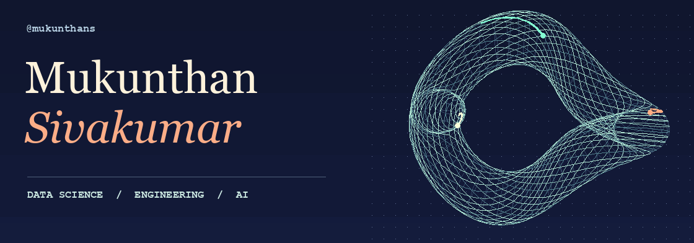

<picture>
  <source media="(prefers-reduced-motion: reduce)" srcset="assets/transaction-trails.png">
  
</picture>

I work with payment gateway transactions at **Jio Payment Solutions**, part of **Jio Financial Services**. Some days I’m figuring out which data a team needs to answer a question. Other days I’m analyzing transactions or building ML models and AI agents that make the data easier to use.

I earned my M.Tech in Computer Science at **IIT Madras**. Outside work, I build things I want to use or share with friends, from a tool that answers questions about a PDF to a card game we can play from different cities.

## Explore my projects

<picture><source media="(prefers-reduced-motion: reduce)" srcset="assets/network.png"></picture> <strong>Data &amp; machine learning</strong> · Transaction graphs, Tamil script, and image recognition

- **[Bitcoin transaction networks](https://github.com/mukunthans/synthetic-btc-analysis)** — How closely do random graphs resemble real Bitcoin activity? I compared the Elliptic dataset with two graph models, looking at transaction timing, clusters, and recurring patterns.
- **[Tamil transliteration](https://github.com/mukunthans/DLAssignment3)** — I trained models to write Tamil words in Tamil script from Latin-letter input. Attention visualizations show which input characters the model focused on.
- **[Neural networks from scratch](https://github.com/mukunthans/DeepLearningA1)** and **[image classification](https://github.com/mukunthans/DLAssignment2)** — I implemented backpropagation in NumPy for Fashion-MNIST and explored CNNs and fine-tuning EfficientNet on iNaturalist images.

<picture><source media="(prefers-reduced-motion: reduce)" srcset="assets/terminal.png"></picture> <strong>Tools &amp; applications</strong> · Ask a PDF, plan an evacuation, or explore a React app

- **[PDF Q&A](https://github.com/mukunthans/pdf-qa)** — Upload a document and ask questions about its contents in a Streamlit app powered by Gemini.
- **[GPU evacuation planning](https://github.com/mukunthans/GPU-A4)** — CUDA code for a routing problem with limited road capacity and shelter space.
- **[MedChain](https://github.com/mukunthans/MedChain1)** — A React app with wallet sign-in and separate views for patients, doctors, and insurers.
- My other React projects include a [Snapdeal-style storefront](https://github.com/mukunthans/snapdeal-clone), a [Quora-style app](https://github.com/mukunthans/quora-submission), and a [pagination demo](https://github.com/mukunthans/pagination_react).

<picture><source media="(prefers-reduced-motion: reduce)" srcset="assets/cards.png"></picture> <strong>Browser games</strong> · Bluff with friends, clear a minefield, or race the clock

- **[Cheat Cards](https://github.com/mukunthans/cheat-cards)** — A multiplayer bluffing game for two to four friends. Open a private room, choose a number, and see who calls your bluff. **[Play online ↗](https://cheat-cards.netlify.app/)**
- **[Minesweeper](https://github.com/mukunthans/Minesweeper-Final)** — Three difficulty levels with different board sizes, mine counts, and time limits.
- **[Speed Typing](https://github.com/mukunthans/SpeedTyping-JS)** — A small browser typing game written in JavaScript.

---

[Browse all repositories ↗](https://github.com/mukunthans?tab=repositories) · Personal portfolio in progress.
